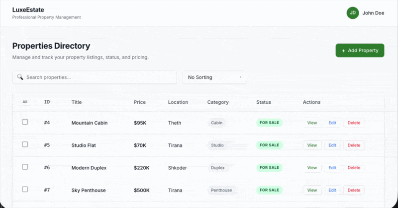

# Property Management Dashboard

A React-based property management dashboard with full CRUD functionality, filtering, sorting, pagination, and bulk actions.



## Features

- Create new property listings
- View detailed property information
- Edit existing properties
- Delete individual properties
- Select and manage multiple properties at once
- Bulk update and delete actions
- Search properties by title
- Sort by price and area
- Filter by property category
- Pagination with configurable entries per page
- Loading skeleton UI
- Confirmation modal for destructive actions
- Responsive dashboard interface

## Tech Stack

- React
- Vite
- JavaScript
- CSS
- JSON Server
- REST API

## Getting Started

### 1. Clone the repository

```bash
git clone <your-repository-url>
cd crud-react
```

### 2. Install dependencies

```bash
npm install
```

### 3. Start the JSON Server

In one terminal:

```bash
npm run server
```

The API will run at:

```text
http://localhost:3001
```

### 4. Start the development server

In another terminal:

```bash
npm run dev
```

The application will be available through the Vite development server.

## Available Scripts

```bash
npm run dev
```

Starts the Vite development server.

```bash
npm run server
```

Starts the JSON Server API using `db.json` on port `3001`.

```bash
npm run build
```

Creates a production build.

```bash
npm run lint
```

Runs Oxlint.

```bash
npm run preview
```

Previews the production build locally.

## API

The project uses JSON Server as a lightweight REST API.

The API provides the following operations:

| Method | Endpoint | Description |
| --- | --- | --- |
| GET | `/properties` | Get all properties |
| GET | `/properties/:id` | Get a single property |
| POST | `/properties` | Create a property |
| PATCH | `/properties/:id` | Update a property |
| DELETE | `/properties/:id` | Delete a property |

The API data is stored in `db.json`.

## Project Structure

```text
crud-react/
├── public/
├── src/
│   ├── api/
│   │   └── properties.js
│   ├── components/
│   │   ├── BulkActions.jsx
│   │   ├── ConfirmationModal.jsx
│   │   ├── Filters.jsx
│   │   ├── HouseList.jsx
│   │   ├── Loading.jsx
│   │   ├── NoProperties.jsx
│   │   ├── Pagination.jsx
│   │   ├── PropertyPerPage.jsx
│   │   ├── Table.jsx
│   │   └── TableHeader.jsx
│   ├── App.jsx
│   ├── App.css
│   ├── PropertyModal.jsx
│   └── index.css
├── db.json
├── index.html
├── package.json
└── crud-demo.gif
```

## Author

David Dundo